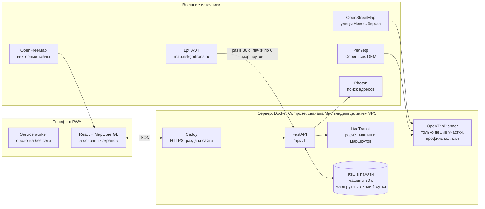

# Архитектура «GoPoint»: итоговая структура и стек

Версия от 4 ноября 2026. Это главный документ о том, как устроен проект. Правила работы лежат в `CLAUDE.md`, экраны в `docs/DESIGN.md`, данные ЦУГАЭТ в `data/tsugaet/NSKGORTRANS.md`.

## 1. Что строим

«GoPoint» это PWA (сайт, который ставится на экран телефона как приложение) для людей на колясках. Человек видит на карте транспорт Новосибирска на линии **прямо сейчас**, вводит точки А и Б и получает маршрут: какая машина через сколько минут подъедет, где пересадка, сколько идти пешком. Настройка «Низкопольный транспорт»: включена (по умолчанию), и маршрут строится только по низкопольным машинам; выключена, и по любому транспорту с пометкой у каждой машины.

**Два этапа.** Сначала демо на компьютере владельца (Mac работает как сервер, можно смотреть результат с компьютера и с телефона), затем покупка сервера и перенос тех же контейнеров. Раздел 14.

## 2. Что изменилось после изучения данных ЦУГАЭТ

| Было в плане | Стало | Почему |
|---|---|---|
| Таблицы CSV вводятся вручную, из них собирается GTFS | Остановки, линии и машины берутся с сайта ЦУГАЭТ автоматически | у сайта есть всё: `listmarsh`, `trasses`, `markers` |
| Низкий пол: «все рейсы маршрутов из списка владельца» | У каждой машины свой признак `ramp` (`1` да, `0` нет), три состояния `yes/no/unknown` | признак есть в данных по каждой машине |
| OpenTripPlanner строит весь маршрут по GTFS | OTP строит только **пешие участки** (улицы, рельеф, профиль коляски); пересадки и ожидание считает наш модуль `LiveTransit` по положению машин | в данных ЦУГАЭТ нет GTFS и расписания рейсов с низким полом, а прогноз остановки не говорит, низкопольная ли машина |
| Браузер ходит за данными сам | Данные берёт **наш сервер** раз в 30 секунд и отдаёт всем | у сайта ЦУГАЭТ нет CORS, и так мы не нагружаем их сервер |
| Админка и отчёты об ошибках | нет | решение владельца |
| Только низкопольный транспорт | настройка «Низкопольный транспорт»: включена (по умолчанию) только `ramp = yes`, выключена любой транспорт с пометкой | решение владельца |
| Профиль коляски | всегда включён для пеших участков на сервере, без переключателя | решение владельца |
| Хостинг сразу на сервере | сначала Mac владельца, затем купленный сервер | решение владельца |

**Запасной вариант А (если расчёт `LiveTransit` не получится или окажется слишком сложным):** собрать из данных ЦУГАЭТ GTFS и подавать положения машин в OTP как GTFS Realtime. Это нужно проверить по документации выбранной версии OTP. Проверка описана в запросе 6 в `PROMPTS.md` (первым шагом, до написания кода).

## 3. Схема



## 4. Полный стек

### Телефон (папка `web/`)
| Что | Выбор | Зачем |
|---|---|---|
| Язык и сборка | TypeScript (strict), Vite | быстрая сборка, строгие типы |
| Интерфейс | React 18 | привычный и хорошо документированный |
| Карта | MapLibre GL JS за портом `MapView` | открытая, векторная, работает с OpenFreeMap |
| Тайлы | OpenFreeMap (адрес в настройке) | бесплатные тайлы OSM, замену можно сделать позже |
| PWA | `vite-plugin-pwa` (Workbox) | установка на экран, оболочка работает без сети |
| Проверка данных | zod | повреждённый ответ сервера не ломает экран |
| Типы API | `openapi-typescript` из OpenAPI сервера | один источник правды |
| Состояние запросов | TanStack Query | обновление раз в 30 с, отмена устаревших, кэш |
| Шрифт | Nunito, файлы в проекте | работает без сети |
| Тесты | Vitest, Playwright (360×640 и 390×844, медленная сеть), axe | см. «Качество» |
| Линтеры | ESLint (`no-restricted-imports`), Prettier | запрет импортов сервисов вне `adapters/` |

### Сервер (папка `server/`)
| Что | Выбор | Зачем |
|---|---|---|
| Язык | Python 3.12 | уже есть разбор данных ЦУГАЭТ на нём |
| Фреймворк | FastAPI, pydantic v2, uvicorn | OpenAPI из коробки |
| Запросы наружу | `httpx` (async), таймауты, ограниченные повторы | не зависать на чужих сервисах |
| Фоновый опрос ЦУГАЭТ | задача `asyncio` внутри сервера | раз в 30 с, только пока кто-то смотрит |
| Кэш | в памяти процесса | базы данных в демо не нужно |
| Ограничение частоты | `slowapi` | защита от перегрузки |
| Тесты | pytest, ruff, mypy (strict), import-linter | как в `CLAUDE.md` |

### Данные и расчёты
| Что | Выбор | Зачем |
|---|---|---|
| Источник транспорта | сайт ЦУГАЭТ, разбор из `data/tsugaet/nskgortrans.py` | маршруты, линии, остановки, машины, признак `ramp` |
| Пешие участки | OpenTripPlanner 2.x в Docker, только улицы | профиль коляски, рельеф; версию закрепить, проверить на Apple Silicon |
| Улицы | выгрузка OpenStreetMap, обрезана по Новосибирску | |
| Рельеф | Copernicus DEM GLO-30 (запасной SRTM) | уклоны |
| Поиск адресов | Photon за портом `Geocoder` | публичный сервер для демо (проверить условия), свой позже |
| Запасной вариант пешехода | Valhalla (профиль пешехода-колясочника) | если у OTP не получится, проверить по документации |

### Запуск и выкладка
| Что | Выбор |
|---|---|
| Контейнеры | Docker Compose (`web` собирается в статику, `server`, `otp`, `caddy`; Photon позже) |
| HTTPS и раздача сайта | Caddy (сертификаты сами) |
| Этап 1: демо | Mac владельца, `docker compose up` (скрипт `scripts/run-demo.sh`); телефон по Wi-Fi или через временный HTTPS-туннель; Mac не должен засыпать |
| Этап 2: сервер | одна VPS 2 vCPU и 4 ГБ ОЗУ (примерно 650–1900 ₽/мес; цены проверить перед покупкой). Переносятся те же контейнеры; OTP требует сервера |
| CI | GitHub Actions: линтеры, типы, тесты, сборка, проверка актуальности типов API |
| Секреты | `.env`, в git только `.env.example` |
| Мониторинг | `/health`, лог без координат, внешняя проверка доступности |

Платных сервисов нет. Опционально позже: ИИ-слой (разбор фразы «от универа до вокзала», пояснения). Для демо он не нужен и требует решения владельца (деньги, приватность).

## 5. Структура репозитория

```
nsk-transit/
├── CLAUDE.md                     правила для Claude Code
├── PROMPTS.md                    последовательность запросов
├── docker-compose.yml            web, server, otp, caddy
├── .env.example
├── scripts/                      run-demo.sh (запуск на Mac), deploy.md (перенос на сервер)
├── docs/
│   ├── ARCHITECTURE.md           этот файл
│   ├── DESIGN.md                 экраны, цвета, тексты
│   ├── DECISIONS.md              решения и «когда пересмотреть»
│   ├── HANDOFF.md                состояние работы для следующей сессии
│   ├── LICENSES.md               условия внешних сервисов
│   ├── DATA_QUALITY.md           что известно о данных ЦУГАЭТ
│   └── design/*.dc.html          образцы экранов
├── data/
│   ├── tsugaet/                  описание сайта ЦУГАЭТ, утилита, образцы ответов
│   │   ├── NSKGORTRANS.md
│   │   ├── nskgortrans.py
│   │   └── samples/*.json
│   └── osm/                      выгрузка улиц и рельеф для OTP (в git не кладём, скрипт загрузки лежит рядом)
├── web/
│   └── src/
│       ├── domain/               типы, правила отображения (без сети и без React)
│       ├── ports/                MapView и другие интерфейсы
│       ├── adapters/maplibre/    карта
│       ├── adapters/api/         клиент сервера, zod, сгенерированные типы
│       ├── features/             start, route, live-routes, live-route, live-stop, vehicle, settings, about, install, low-floor-toggle
│       ├── shared/               тексты `ru`, компоненты, нижняя панель
│       └── pwa/                  манифест, service worker, иконки
└── server/
    └── app/
        ├── domain/               модели: Vehicle, Stop, Line, Journey, Leg, Accessibility
        ├── ports/                Geocoder, WalkPlanner, TransitFeed
        ├── adapters/
        │   ├── tsugaet/          TransitFeed на основе nskgortrans.py
        │   ├── otp/              WalkPlanner на OpenTripPlanner
        │   ├── photon/           Geocoder
        │   └── fake/             заглушки для тестов
        ├── services/             live_snapshot, eta, journey_search, reroute, meta
        ├── api/                  маршруты /api/v1
        └── config.py             настройки из окружения
```

## 6. Порты и адаптеры

| Порт | Что делает | Основной адаптер | Замена позже |
|---|---|---|---|
| `TransitFeed` | список маршрутов, линии и остановки, машины сейчас | `tsugaet` | официальный GTFS-Realtime города |
| `WalkPlanner` | пеший маршрут и время для коляски между двумя точками | `otp` | Valhalla |
| `Geocoder` | поиск адресов и мест | `photon` | свой Photon |
| `MapView` (сайт) | карта, маркеры, линия маршрута | `maplibre` | другая карта |

Правила: сторонние адреса, SDK и ключи импортируются только в `adapters/`; `domain/` ничего не знает про адаптеры; координаты везде `{ lat, lon }`.

## 7. Поток данных

1. **Опрос ЦУГАЭТ.** Сервер раз в 30 секунд забирает `markers.php` пачками по 6 маршрутов (около 18 запросов на 104 маршрута, пауза 0,5 с между ними). Опрос идёт, только если за последние 2 минуты кто-то обращался к API. Ночью и без пользователей сервер ЦУГАЭТ не нагружается.
2. **Разбор.** Время `time_nav` (местное, UTC+7) переводится в UTC. `ramp` даёт `yes/no/unknown`. Машины, которые скрывает сайт ЦУГАЭТ (отстой, обед, без плана), и машины со свежестью старше порога (5 минут, настройка) отбрасываются.
3. **Кэш.** Маршруты и линии (`listmarsh`, `trasses` по направлениям A и B) на сутки; машины на 30 секунд. Если ЦУГАЭТ не отвечает, отдаём прошлый снимок с пометкой времени.
4. **Выдача.** В приложение уходят уже разобранные данные. Параметр `lowFloorOnly` (по умолчанию `true`): при `true` на карте и в расчётах только `yes`; при `false` все машины на линии, у каждой поле `lowFloor` (`yes/no/unknown`) для пометки. Свежесть и способ расчёта времени сервер отдаёт в служебных полях для логов и тестов; **интерфейс их не показывает**.

## 8. Как считается маршрут «сейчас» (`LiveTransit`)

1. Для каждой допустимой машины (при `lowFloorOnly = true` только `yes`) определяем положение на линии: проекция точки GPS на линию маршрута и направления (`segment_order` как проверка ±1). Получаем остановки впереди.
2. Время прихода на каждую остановку впереди: если в плане машины (`rasp`) есть эта остановка и время в будущем, берём его; иначе расстояние по линии, делённое на скорость (скорость машины, но не ниже `MIN_SPEED`, плюс `DWELL` секунд на остановку; обе настройки). Способ записывается в служебное поле, в интерфейсе не показывается.
3. Из этого строится список «соединений»: машина, остановка посадки, остановка выхода, время отправления и прибытия, на горизонте 60 минут вперёд.
4. Пешие участки считает `WalkPlanner` (OTP): от точки А до нескольких ближайших остановок, от остановок до точки Б, между остановками для пересадок (в радиусе пересадки, настройка). Лимита расстояния до остановки нет: берём ближайшие `K` остановок, ответы кэшируются.
5. Поиск: самое раннее прибытие, до двух пересадок (алгоритм Connection Scan), запас на посадку и пересадку из настройки. Возвращаем лучший вариант и до двух запасных.
6. **Пересчёт.** Пока человек едет или ждёт, приложение раз в 30 секунд сверяет выбранную машину: если она стоит дольше порога (5 минут) или пропала, сервер предлагает новый вариант (экран `FriendlyRerouted`). Заменяет маршрут только человек.
7. Нет подходящих машин: ответ «Транспорта сейчас нет» (серый блок), без подмены пешим маршрутом. Пешие участки всегда считаются по профилю коляски, независимо от кнопки.

**Что пока неизвестно и проверяется:**
- что именно значит `ramp` (низкий пол, аппарель или и то и другое) и обновляется ли признак при поломке аппарели (вопрос к ЦУГАЭТ);
- насколько точны `segment_order` и `rasp` (проверка по образцам и живым данным, результат в `docs/DATA_QUALITY.md`);
- поддерживает ли выбранная версия OTP профиль коляски для улиц и как задать рельеф (документация).

## 9. API сервера (`/api/v1`, источник правды: OpenAPI)

| Метод | Адрес | Что отдаёт |
|---|---|---|
| GET | `/meta` | границы города, версия, пороги (свежесть данных только в служебных полях) |
| GET | `/search?q=` | подсказки адресов |
| POST | `/route` | от точки, до точки, `lowFloorOnly`: до 3 вариантов с шагами, временем, пометками |
| GET | `/live/vehicles?bbox=&lowFloorOnly=` | машины на линии для карты |
| GET | `/live/routes?lowFloorOnly=` | маршруты с числом машин на линии, фильтр по виду |
| GET | `/live/routes/{id}` | остановки по порядку и машины между ними |
| GET | `/live/stops/{id}/arrivals` | что подъезжает к остановке |
| GET | `/live/vehicles/{id}` | карточка машины |
| GET | `/health` | проверка работы |

Единый формат ошибки: `code`, `message` (по-русски), `details`.

## 10. Нагрузка и бережность к чужому серверу

- Один опрос на всех пользователей, не на каждого.
- Не чаще раза в 30 секунд; паузы между запросами; опрос останавливается, если пользователей нет.
- Идентифицируемый `User-Agent`, без личных данных; сеть и сбои логируем без координат пользователей.
- Письменное разрешение ЦУГАЭТ и допустимая частота: вопрос к ним в открытых вопросах (`data/tsugaet/NSKGORTRANS.md`).

## 11. Безопасность и приватность

- Координаты пользователей не сохраняются и не попадают в логи; геолокация только по кнопке.
- OTP и внутренние сервисы наружу не публикуются; наружу только Caddy.
- CORS по списку, проверка ввода, ограничение частоты запросов.
- Секреты в `.env`.

## 12. Качество

- Тесты вперёд для чистой логики: разбор ЦУГАЭТ (на `samples/`), время `time_nav`, проекция на линию, оценка прихода, поиск маршрута, пересадки, пересчёт.
- Контрактные тесты адаптеров; сетевые тесты отдельно и вручную.
- e2e Playwright на размерах телефона, медленная сеть, axe.
- Проверка «что если»: ЦУГАЭТ не отвечает, ответ странный, у машины нет `ramp`, время `time_nav` старое.

## 13. Открытые вопросы

К ЦУГАЭТ: смысл `ramp`, официальный канал (GTFS и GTFS-Realtime), письменное разрешение и допустимая частота, бортовой номер, смысл `segment_order`.

К владельцу: пороги (свежесть положения 5 минут, «машина стоит» 5 минут, скорость коляски, запас на посадку), когда и какой сервер покупать, бюджет, как показывать демо на телефоне (Wi-Fi или туннель).

К проверке по документации: OTP (профиль коляски, рельеф, версия образа), Photon (условия публичного сервера), OpenFreeMap (пределы).

## 14. Два этапа запуска

**Этап 1: демо на Mac владельца.** `scripts/run-demo.sh` проверяет Docker, поднимает `web`, `server`, `otp`, `caddy` и печатает два адреса: для компьютера и для телефона (по Wi-Fi). Геолокация на телефоне работает только по HTTPS: если нужна, скрипт поднимает временный туннель, решение записать в `DECISIONS.md`. Ограничения, о которых нужно сказать владельцу: Mac не должен засыпать, Docker Desktop должен выделять OTP не менее 4 ГБ (проверить), сервис виден только в вашей сети, пока не открыт туннель, нагрузка на ЦУГАЭТ та же (опрос только при наличии пользователей).

**Этап 2: купленный сервер.** Те же образы и `docker-compose.yml`; меняются `.env` (адрес, секреты), домен и Caddy. Порядок переноса записан в `scripts/deploy.md`. До письменного разрешения ЦУГАЭТ сервис в общий доступ не открывается.
