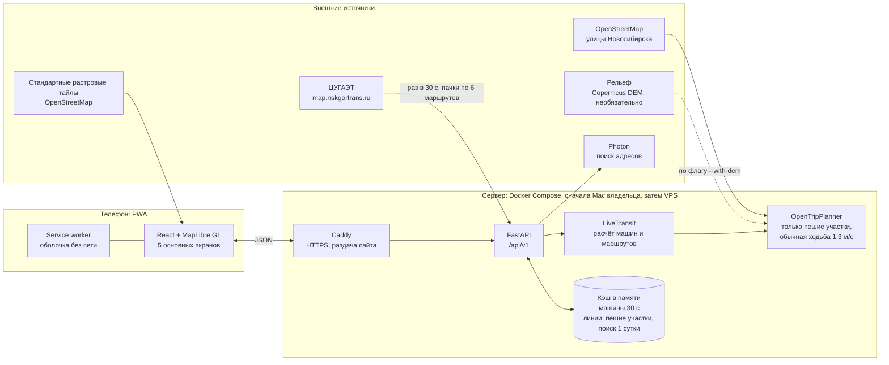

> Справочник реализованного устройства до шага 04. Целевая архитектура и обязательные проверки для Sol — [ROUTING.md](ROUTING.md), краткое [сравнение](CURRENT_AND_TARGET.md). Здесь описан старый поиск по машинам, не требования к новой реализации. Очередность и статус — в [плане](ROADMAP.md).

# Архитектура «GoPoint»: итоговая структура и стек

Это справочник о продуктовом коде до реализации шага 04 (сверен 21 ноября 2026; текущая рабочая ветка `codex/04-route-options` пока содержит только план и аудит). Правила работы лежат в `AGENTS.md`, экраны в `docs/DESIGN.md`, данные ЦУГАЭТ в `data/tsugaet/NSKGORTRANS.md`.

Целевой переход: один общий расчёт расписания и прогноза, low-выборка по подтверждённой машине, один OTP. Подготовленная уличная часть используется повторно; изменение базовых транспортных данных вызывает только транспортную сборку, GPS меняет GTFS-Realtime без сборки. Эти механизмы пока не реализованы; не переносить старые `is_usable`/поиск по оставшимся остановкам в новые сервисы без правил `ROUTING.md` §5.3.

## 1. Что строим

«GoPoint» это PWA (сайт, который ставится на экран телефона как приложение) для поездок по Новосибирску. Человек видит на карте транспорт Новосибирска на линии **прямо сейчас**, вводит точки А и Б и получает маршрут: какая машина через сколько минут подъедет, где пересадка, сколько идти пешком. По умолчанию доступны все машины. В настройках можно включить фильтр «Низкопольный транспорт».

**Два этапа.** Сначала демо на компьютере владельца (Mac работает как сервер, можно смотреть результат с компьютера и с телефона), затем покупка сервера и перенос тех же контейнеров. Раздел 14.

## 2. Что изменилось после изучения данных ЦУГАЭТ

| Было в плане | Стало | Почему |
|---|---|---|
| Таблицы CSV вводятся вручную, из них собирается GTFS | Остановки, линии и машины берутся с сайта ЦУГАЭТ автоматически | у сайта есть всё: `listmarsh`, `trasses`, `markers` |
| Низкий пол: «все рейсы маршрутов из списка владельца» | У каждой машины свой признак `ramp` (`1` да, `0` нет), три состояния `yes/no/unknown` | признак есть в данных по каждой машине |
| OpenTripPlanner строит весь маршрут по GTFS | OTP строит только **пешие участки** (улицы, обычный пешеход, 1,3 м/с); пересадки и ожидание считает наш модуль `LiveTransit` по положению машин | в данных ЦУГАЭТ нет GTFS и расписания рейсов с низким полом, а прогноз остановки не говорит, низкопольная ли машина |
| Браузер ходит за данными сам | Данные берёт **наш сервер** раз в 30 секунд и отдаёт всем | у сайта ЦУГАЭТ нет CORS, и так мы не нагружаем их сервер |
| Админка и отчёты об ошибках | нет | решение владельца |
| Только низкопольный транспорт | настройка «Низкопольный транспорт»: включена только `ramp = yes`, по умолчанию выключена, любой транспорт с пометкой | решение владельца |
| Профиль коляски | обычная ходьба по уличному графу OTP | решение владельца |
| Хостинг сразу на сервере | сначала Mac владельца, затем купленный сервер | решение владельца |

Переход на маршруты по расписанию ЦУГАЭТ описан в [ROADMAP.md](ROADMAP.md) (шаг 04) и [CURRENT_AND_TARGET.md](CURRENT_AND_TARGET.md). Сейчас `LiveTransit` — понятие из документации, в коде это `JourneyPlanner` и модули `domain/linear.py`, `domain/journey_search.py`.

## 3. Схема



## 4. Полный стек

### Телефон (папка `web/`)
| Что | Выбор | Зачем |
|---|---|---|
| Язык и сборка | TypeScript (strict), Vite | быстрая сборка, строгие типы |
| Интерфейс | React 19 | привычный и хорошо документированный |
| Карта | MapLibre GL JS за портом `MapView` | открытая, WebGL |
| Тайлы | растровые тайлы OpenStreetMap (адрес в `VITE_OSM_TILE_URL` / `GOPOINT_OSM_TILE_URL`) | подложка без ключей; условия — в `LICENSES.md` |
| PWA | `vite-plugin-pwa` (Workbox) | установка на экран, оболочка работает без сети |
| Проверка данных | zod | повреждённый ответ сервера не ломает экран |
| Типы API | `openapi-typescript` из OpenAPI сервера | один источник правды |
| Состояние запросов | TanStack Query | обновление раз в 30 с, отмена устаревших, кэш |
| Шрифт | Nunito через `@fontsource/nunito` | работает без сети |
| Тесты | Vitest, Playwright (360×640, 390×844, 393×852, медленная сеть), axe | см. «Качество» |
| Линтеры | ESLint (`no-restricted-imports`), Prettier | запрет импортов сервисов вне `adapters/` |

### Сервер (папка `server/`)
| Что | Выбор | Зачем |
|---|---|---|
| Язык | Python 3.12 | уже есть разбор данных ЦУГАЭТ на нём |
| Фреймворк | FastAPI, pydantic v2, uvicorn | OpenAPI из коробки |
| Запросы наружу | `httpx` (async), таймауты, ограниченные повторы | не зависать на чужих сервисах |
| Фоновый опрос ЦУГАЭТ | задача `asyncio` внутри сервера | раз в 30 с, только пока кто-то смотрит |
| Кэш | в памяти процесса | базы данных в демо не нужно |
| Ограничение частоты | собственный ASGI-middleware `RateLimitMiddleware` (`api/rate_limit.py`, скользящее окно 1 минута, по умолчанию 300 запросов, `GOPOINT_RATE_LIMIT_PER_MIN`) | защита от перегрузки |
| Тесты | pytest, ruff, mypy (strict), import-linter | правила — в `AGENTS.md` |

### Данные и расчёты
| Что | Выбор | Зачем |
|---|---|---|
| Источник транспорта | сайт ЦУГАЭТ, разбор из `data/tsugaet/nskgortrans.py` | маршруты, линии, остановки, машины, признак `ramp` |
| Пешие участки | OpenTripPlanner 2.10.0 в Docker, только улицы | путь по всем улицам (режим коляски убран 14.11), обычная ходьба 1,3 м/с; версия закреплена |
| Улицы | выгрузка OpenStreetMap, обрезана по Новосибирску | |
| Рельеф | Copernicus DEM GLO-30, необязательно (`build-otp-graph.sh --with-dem`, по умолчанию выключен) | уклоны |
| Поиск адресов | Photon за портом `Geocoder` | свой Photon только по Новосибирску (контейнер `photon`, база из выгрузки GraphHopper, `scripts/build-photon-db.sh`) |

### Запуск и выкладка
| Что | Выбор |
|---|---|
| Контейнеры | Docker Compose: сервисы `server`, `photon`, `otp`, `caddy` (сайт собирается из `web/Dockerfile` и раздаётся сервисом `caddy`) |
| HTTPS и раздача сайта | Caddy (сертификаты сами) |
| Этап 1: демо | Mac владельца, `docker compose up` (скрипт `scripts/run-demo.sh`); телефон по Wi-Fi или через временный HTTPS-туннель; Mac не должен засыпать |
| Этап 2: сервер | одна VPS 2 vCPU и 4 ГБ ОЗУ (примерно 650–1900 ₽/мес; цены проверить перед покупкой). Переносятся те же контейнеры; OTP требует сервера |
| CI | GitHub Actions: линтеры, типы, тесты, сборка, проверка актуальности типов API |
| Секреты | `.env`, в git только `.env.example` |
| Мониторинг | `/health`, лог без координат, внешняя проверка доступности |

Платных сервисов нет. Опционально позже: ИИ-слой (разбор фразы «от универа до вокзала», пояснения). Для демо он не нужен и требует решения владельца (деньги, приватность).

## 5. Структура репозитория

```
GoPoint/
├── AGENTS.md, CLAUDE.md, README.md
├── docker-compose.yml            server, photon, otp, caddy
├── .env.example
├── scripts/                      run-demo/stop-demo, run-tunnel/stop-tunnel, build-otp-graph, build-photon-db, check-all, check-mac
├── otp/                          build-config.json, router-config.json, tools.Dockerfile
├── photon/                       Dockerfile и скрипты своего Photon
├── docs/
│   ├── ARCHITECTURE.md           этот файл
│   ├── DESIGN.md                 экраны, цвета, тексты
│   ├── DECISIONS.md              решения и «когда пересмотреть»
│   ├── ROADMAP.md                план, статус, точка продолжения
│   ├── CURRENT_AND_TARGET.md     что есть сейчас и к чему идём
│   ├── DEMO_RUN.md, DEMO_CHECKLIST.md  запуск и сценарий показа
│   ├── LICENSES.md               условия внешних сервисов
│   ├── DATA_QUALITY.md           что известно о данных ЦУГАЭТ
│   ├── design/*.dc.html          образцы экранов
│   └── demo/                     снимки экранов и запись показа
├── data/
│   ├── tsugaet/                  описание сайта ЦУГАЭТ, утилита, образцы ответов
│   │   ├── NSKGORTRANS.md
│   │   ├── nskgortrans.py
│   │   └── samples/*.json
│   ├── osm/                      выгрузка OSM (в git не кладём)
│   ├── otp/                      вырезанный город, граф OTP (в git не кладём)
│   ├── geocoder/                 список мест и отчёты проверки поиска
│   └── walk/                     проверка пеших участков
├── web/
│   └── src/
│       ├── domain/               типы, правила отображения (без сети и без React)
│       ├── ports/                Geolocation, Installer, LiveApi, MapView, PlaceSearch, Storage, StreetImagery
│       ├── adapters/             api, maplibre, map-list (список вместо карты), yandex-panorama, geolocation, storage, pwa
│       ├── features/             start, route, trip, live-routes, live-route, live-stop, vehicle, settings, about, install
│       └── shared/               тексты `ru`, настройки (в т. ч. низкопольный фильтр), компоненты, нижняя панель
│   (манифест и service worker генерирует `vite.config.ts` через vite-plugin-pwa, иконки в `public/icons`)
└── server/
    └── app/
        ├── domain/               models, geo, access, area, linear, live, journey_search, search, local_places
        ├── ports/                Geocoder, WalkPlanner, TransitFeed
        ├── adapters/
        │   ├── tsugaet/          TransitFeed на основе nskgortrans.py
        │   ├── otp/              WalkPlanner на OpenTripPlanner
        │   ├── photon/           Geocoder
        │   ├── local_places/     свои названия мест (aliases_nsk.csv)
        │   ├── osm_boundary/     граница города
        │   └── fake/             заглушки для тестов
        ├── services/             cache, geocoding, journey_planner, live_snapshot, walking
        ├── api/                  v1 (маршруты /api/v1), schemas, errors, rate_limit
        ├── main.py, wiring.py, openapi_export.py
        └── config.py             настройки из окружения
    (server/tools — проверки данных; server/tests — тесты)
```

## 6. Порты и адаптеры

| Порт | Что делает | Основной адаптер | Замена позже |
|---|---|---|---|
| `TransitFeed` | список маршрутов, линии и остановки, машины сейчас | `tsugaet` | официальный GTFS-Realtime города |
| `WalkPlanner` | пеший маршрут и время ходьбы между двумя точками | `otp` | нет |
| `Geocoder` | поиск адресов и мест | `photon` (в compose — свой Photon по Новосибирску; публичный сервер komoot — значение по умолчанию в `config.py`) | нет |
| `MapView` (сайт) | карта, маркеры, линия маршрута | `maplibre`, запасной `map-list` | другая карта |

Правила: сторонние адреса, SDK и ключи импортируются только в `adapters/`; `domain/` ничего не знает про адаптеры; координаты везде `{ lat, lon }`.

## 7. Поток данных

1. **Опрос ЦУГАЭТ.** Сервер раз в 30 секунд забирает `markers.php` пачками по 6 маршрутов (пауза 0,5 с между запросами; число запросов зависит от числа маршрутов в данных, см. `DATA_QUALITY.md`). Опрос идёт, только если за последние 2 минуты кто-то обращался к API. Ночью и без пользователей сервер ЦУГАЭТ не нагружается.
2. **Разбор.** Время `time_nav` (местное, UTC+7) переводится в UTC. `ramp` даёт `yes/no/unknown`. Машины, которые скрывает сайт ЦУГАЭТ (отстой, обед, без плана), и машины со свежестью старше порога (5 минут, настройка) отбрасываются.
3. **Кэш.** Маршруты и линии (`listmarsh`, `trasses` по направлениям A и B) на сутки; машины на 30 секунд. Если ЦУГАЭТ не отвечает, отдаём прошлый снимок с пометкой времени (до 5 минут). Линия без машин дольше 2 суток (`line_hide_after_s`) скрывается из «Транспорт сейчас».
4. **Выдача.** В приложение уходят уже разобранные данные. Параметр `lowFloorOnly` (по умолчанию `false`): при `true` на карте и в расчётах только `yes`; при `false` все машины на линии, у каждой поле `lowFloor` (`yes/no/unknown`) для пометки. Свежесть и способ расчёта времени сервер отдаёт в служебных полях для логов и тестов; **интерфейс их не показывает**.

## 8. Как считается маршрут «сейчас» (`LiveTransit`)

1. Для каждой допустимой машины (при `lowFloorOnly = true` только `yes`) определяем положение на линии: проекция точки GPS на линию маршрута и направления (`segment_order` как проверка ±1). Получаем остановки впереди.
2. Время прихода на каждую остановку впереди: если в плане машины (`rasp`) есть эта остановка и время в будущем, берём его; иначе расстояние по линии, делённое на скорость (скорость машины в пределах `vehicle_min_speed_kmh`–`vehicle_max_speed_kmh` (15–40 км/ч), плюс `dwell_s` (20 с) на остановку). Способ записывается в служебное поле, в интерфейсе не показывается.
3. Из этого строится список «соединений»: машина, остановка посадки, остановка выхода, время отправления и прибытия, на горизонте 60 минут вперёд.
4. Пешие участки считает `WalkPlanner` (OTP): от точки А до остановок, от остановок до точки Б, между остановками для пересадок (в радиусе пересадки, настройка). Остановки: `K` ближайших плюс ближайшая каждого маршрута и направления в радиусе 1500 м, не больше 40 (`domain/access.py`). Лимита расстояния нет, ответы кэшируются. Если пересадка по улицам дольше оценки, поиск повторяется с настоящим временем. Варианты хуже пути пешком отбрасываются; если отброшены все, ответ `walk_better` («Пешком быстрее»).
5. Поиск: самое раннее прибытие, до двух пересадок (поиск по кругам, как RAPTOR), запас 30 с на посадку и дополнительно 60 с на пересадку после перехода по улицам. Возвращаем до трёх вариантов с ярлыками «быстрее», «меньше пересадок», «меньше пешком» (и запасные на других машинах). Отдельно сервер считает путь пешком прямо от А до Б и присылает его в поле `walk`, если он не длиннее 2 км (`GOPOINT_WALK_OPTION_MAX_M`): это выбор человека, маршрут им не подменяется.
6. **Пересчёт.** Пока человек едет или ждёт, приложение раз в 30 секунд сверяет выбранную машину: если она стоит дольше порога (5 минут) или пропала, сервер возвращает статус `ok`, `stopped`, `late` (порог 180 с) или `gone` и при возможности более быстрый вариант (на экране — блок «Есть вариант быстрее»). Заменяет маршрут только человек.
7. Нет подходящих машин: ответ «Транспорта сейчас нет» (серый блок), без подмены пешим маршрутом. Пешие участки считаются по всем улицам со скоростью обычной ходьбы, независимо от кнопки; ступени показываются пометкой.

**Что пока неизвестно и проверяется:**
- что именно значит `ramp` (низкий пол, аппарель или и то и другое) и обновляется ли признак при поломке аппарели (вопрос к ЦУГАЭТ);
- насколько точны `segment_order` и `rasp` (проверка по образцам и живым данным, результат в `docs/DATA_QUALITY.md`);
- как задать рельеф без ложных подъёмов (рельеф сейчас выключен).

## 9. API сервера (`/api/v1`, источник правды: OpenAPI)

| Метод | Адрес | Что отдаёт |
|---|---|---|
| GET | `/meta` | границы города, версия, пороги (свежесть данных только в служебных полях) |
| GET | `/search?q=` | подсказки адресов и мест в Новосибирске (от 3 букв) |
| GET | `/search/reverse?lat=&lon=` | адрес у точки, выбранной на карте («Выбрать на карте») |
| POST | `/walk` | служебный: пеший участок по улицам между двумя точками (время, метры, линия, `hasStairs`) |
| POST | `/route` | от точки, до точки, `lowFloorOnly`: до 3 вариантов с шагами, временем, пометками (у поездки: остановок ехать, остановок машине до посадки, конечная, линия для карты); `status: no_transit` и «Транспорта сейчас нет», если машин нет |
| POST | `/route/check` | пересчёт выбранного маршрута: машина стоит / пропала / опаздывает, тот же маршрут с новым временем и предложение (не заменяет) |
| GET | `/live/vehicles?bbox=&lowFloorOnly=` | машины на линии для карты |
| GET | `/live/routes?lowFloorOnly=` | маршруты с числом машин на линии, фильтр по виду |
| GET | `/live/routes/{id}` | остановки по порядку и машины между ними |
| GET | `/live/stops?bbox=` | остановки в видимой области карты (область не больше ~15 км, иначе `BAD_BBOX`) |
| GET | `/live/stops/{id}/arrivals` | что подъезжает к остановке |
| GET | `/live/vehicles/{id}` | карточка машины |
| GET | `/health` | проверка работы |

Единый формат ошибки: `code`, `message` (по-русски), `details`.

## 10. Нагрузка и бережность к чужому серверу

- Один опрос на всех пользователей, не на каждого.
- Не чаще раза в 30 секунд; паузы между запросами; опрос останавливается, если пользователей нет.
- Идентифицируемый `User-Agent`, без личных данных; сеть и сбои логируем без координат пользователей.
- Письменное разрешение ЦУГАЭТ и допустимая частота: вопрос к ним в открытых вопросах (`data/tsugaet/NSKGORTRANS.md`).

## 11. Безопасность и приватность

- Координаты пользователей не сохраняются и не попадают в логи; геолокация только по кнопке.
- OTP и внутренние сервисы наружу не публикуются; наружу только Caddy.
- CORS по списку, проверка ввода, ограничение частоты запросов.
- Секреты в `.env`.

## 12. Качество

- Тесты вперёд для чистой логики: разбор ЦУГАЭТ (на `samples/`), время `time_nav`, проекция на линию, оценка прихода, поиск маршрута, пересадки, пересчёт.
- Контрактные тесты адаптеров; сетевые тесты отдельно и вручную.
- e2e Playwright на размерах телефона, медленная сеть, axe.
- Проверка «что если»: ЦУГАЭТ не отвечает, ответ странный, у машины нет `ramp`, время `time_nav` старое.

## 13. Открытые вопросы

К ЦУГАЭТ: смысл `ramp`, официальный канал (GTFS и GTFS-Realtime), письменное разрешение и допустимая частота, бортовой номер, смысл `segment_order`.

К владельцу: когда и какой сервер покупать, бюджет. Пороги уже заданы в `server/app/config.py` и `.env.example` (свежесть 300 с, «машина стоит» 300 с, ходьба 1,3 м/с, запас на посадку 30 с, на пересадку 60 с).

К проверке по документации: условия тайл-сервера OSM и публичного Photon (`LICENSES.md`).

## 14. Два этапа запуска

**Этап 1: демо на Mac владельца.** `scripts/run-demo.sh` проверяет Docker, поднимает `server`, `photon`, `otp`, `caddy` и печатает два адреса: для компьютера и для телефона (по Wi-Fi). Геолокация на телефоне работает только по HTTPS: если нужна, скрипт поднимает временный туннель, решение записать в `DECISIONS.md`. Ограничения, о которых нужно сказать владельцу: Mac не должен засыпать, Docker Desktop должен выделять OTP не менее 4 ГБ (проверить), сервис виден только в вашей сети, пока не открыт туннель, нагрузка на ЦУГАЭТ та же (опрос только при наличии пользователей).

**Этап 2: купленный сервер.** Те же образы и `docker-compose.yml`; меняются `.env` (адрес, секреты), домен и Caddy. Отдельной инструкции по переносу пока нет. До письменного разрешения ЦУГАЭТ сервис в общий доступ не открывается.

## 15. Граф улиц для пеших участков (OpenTripPlanner)

Пересборка одной командой: `bash scripts/build-otp-graph.sh` (свежие улицы: `--fresh`, рельеф: `--with-dem`).

1. Скачивается выгрузка OpenStreetMap по Сибирскому округу (Geofabrik, ~590 МБ) в `data/osm/`.
2. `osmium extract` (образ из `otp/tools.Dockerfile`) вырезает прямоугольник города (`GOPOINT_CITY_*` + 0,02°) в `data/otp/novosibirsk.osm.pbf`.
3. В `data/otp/` копируются `otp/build-config.json` и `otp/router-config.json` (общие настройки сервера OTP).
4. `docker compose run otp --build --save` собирает `data/otp/graph.obj`, затем запускается сервис `otp` (`--load --serve`).

Сервер обращается к OTP по `GOPOINT_OTP_URL` (`http://otp:8080`), GraphQL `/otp/gtfs/v1`. Наружу OTP не открыт.
В `otp/router-config.json` сейчас только таймаут `apiProcessingTimeout`; настройки применяются после `build-otp-graph.sh`.

## 16. Граница города

Файл `server/app/adapters/osm_boundary/novosibirsk_city.geojson` — «городской округ Новосибирск»
(OpenStreetMap, relation 1751445). Как обновить (после `build-otp-graph.sh`, когда есть выгрузка Сибири):

```bash
docker run --rm -v "$PWD/data:/data" gopoint-osm-tools:local getid -r --overwrite -o /data/otp/city.osm.pbf /data/osm/siberian-fed-district.osm.pbf r1751445
docker run --rm -v "$PWD/data:/data" gopoint-osm-tools:local export --overwrite -f geojson -o /data/otp/city.geojson /data/otp/city.osm.pbf
```

Затем оставить в файле только объект «городской округ Новосибирск», округлить координаты до 5 знаков
и положить на место прежнего файла. Другой файл можно задать настройкой `GOPOINT_CITY_BOUNDARY_FILE`.

## 17. Модуль LiveTransit (как устроен код)

- `domain/linear.py` — положение машины на линии и время прихода на остановки впереди (пункты 1–2 раздела 8).
- `domain/journey_search.py` — поиск по кругам (до 3 поездок), запасные варианты, проверка выбранной машины.
- `services/journey_planner.py` — собирает машины из снимка, линии всех маршрутов (`LiveSnapshotService.network`,
  сутки), пешие участки через `WalkingService` (OTP) и превращает найденное в шаги `Journey`.
- `domain/area.py` — «точка в городе».
